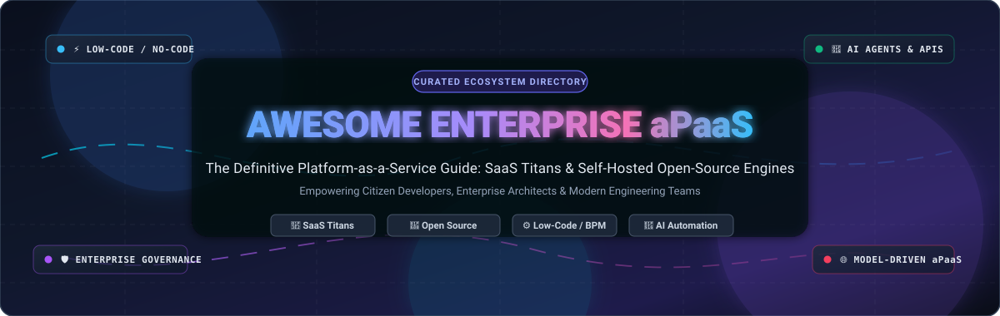
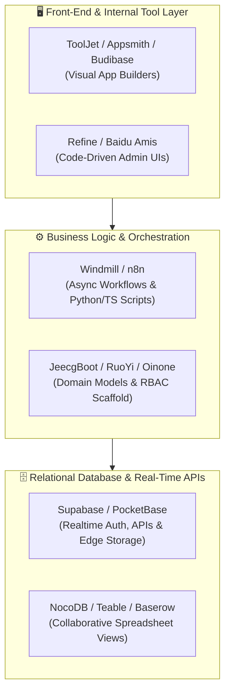

# 🚀 Awesome Enterprise Platform-as-a-Service (aPaaS)

  

  
  
  
  
  
  
  

---

> 💡 **A curated directory of enterprise Application Platform-as-a-Service (aPaaS), low-code development platforms (LCDP), no-code tools, and self-hosted open-source software architectures.**  
> Designed for enterprise architects, software engineers, CIOs, and citizen developers building mission-critical business applications, internal tools, and automated workflows.

---

## 📑 Table of Contents

- [📌 Introduction & SEO Overview](#-introduction--seo-overview)
- [📊 Sector Overview & Market Dynamics](#-sector-overview--market-dynamics)
- [🏢 Enterprise SaaS aPaaS Platforms](#-enterprise-saas-apaas-platforms)
  - [SaaS Pricing & Scale Comparison Table](#saas-pricing--scale-comparison-table)
  - [Detailed SaaS Platform Highlights](#detailed-saas-platform-highlights)
- [🚀 Open-Source GitHub Projects](#-open-source-github-projects)
  - [Top Open-Source Projects (Ranked by Stars)](#top-open-source-projects-ranked-by-stars)
- [🏗️ Recommended Architecture Blueprints](#️-recommended-architecture-blueprints)
- [❓ Frequently Asked Questions (FAQ)](#-frequently-asked-questions-faq)
- [🤝 How to Contribute](#-how-to-contribute)
- [💖 Support](#-support)
- [⭐ Star History](#-star-history)
- [⚖️ Disclaimer & Governance](#️-disclaimer--governance)

---

## 📌 Introduction & SEO Overview

**Enterprise Platform-as-a-Service (aPaaS)** represents cloud-based environments that provide rapid development, deployment, execution, and management of business applications. Unlike generic infrastructure PaaS, an aPaaS delivers high-productivity application building blocks—such as visual UI designers, drag-and-drop workflow builders, metadata-driven data persistence, role-based access control (RBAC), and AI integration.

### 🎯 Key Search Topics & Concepts Covered
`Enterprise aPaaS` • `Low-Code Application Platform (LCAP)` • `No-Code App Builders` • `Citizen Development` • `Rapid Application Development (RAD)` • `Business Process Management (BPM)` • `Self-Hosted Internal Tools` • `Open-Source Airtable Alternatives` • `Open-Source Retool Alternatives` • `Enterprise Metadata Frameworks` • `AI-Augmented Software Engineering`

---

## 📊 Sector Overview & Market Dynamics

The global **Enterprise Application Platform-as-a-Service (aPaaS)** and Low-Code Development Platform market was valued at **$30.2 billion in 2024–2025** and is projected to surpass **$85+ billion by 2030–2032**, expanding at a sustained **CAGR of ~21–24%**.

Market concentration is **moderately concentrated** at the top tier: enterprise tech titans and cloud hyperscalers (**Microsoft, Salesforce, ServiceNow, SAP, Oracle**) command dominant market share by capitalizing on their existing ERP/CRM customer footprints, cloud infrastructure bundles, and IT procurement lock-in. Conversely, the market remains **moderately fragmented** across mid-market, developer-focused, and niche operational categories, where specialized low-code platforms and open-source self-hosted solutions are experiencing explosive organic adoption among agile product and internal tooling teams.

---

## 🏢 Enterprise SaaS aPaaS Platforms

### SaaS Pricing & Scale Comparison Table

The table below is **sorted descending by Company Scale** (Market Capitalization / Enterprise Valuation and Annual Revenue).

| 🏢 Platform / Product | 💰 Company Scale (Valuation & Revenue) | 💵 Starting Tier Pricing | 🎁 Free Tier / Trial Limits | ⚡ Core Capabilities & Differentiators |
| :--- | :--- | :--- | :--- | :--- |
| **[Microsoft Power Platform](https://powerplatform.microsoft.com/)** | **~$3.10T Market Cap** *(Revenue: ~$245.1B FY24)* | **$20/user/month** (Power Apps Premium) or **$10/user/app/month** (Azure Pay-As-You-Go) | **30-day free trial** with full premium feature access; permanently free **Power Apps Developer Plan** for 1 user (up to 3 dev environments, 2 GB Dataverse database capacity, 750 workflow runs/month, non-production) | Canvas & model-driven apps, Power Automate, Copilot Studio, Dataverse, 1,000+ connectors, deep M365 and Azure synergy |
| **[Oracle APEX](https://apex.oracle.com/)** | **~$480B Market Cap** *(Revenue: ~$53.0B FY24)* | **$122/month** (OCI APEX Service: 2 ECPUs @ $0.0807/hr + 20 GB storage; unlimited end users & apps) | **Always Free Tier on OCI** (2 Autonomous Database instances with APEX, 20 GB storage each, 1 ECPU, ~30 simultaneous connections; or 30-day $300 trial credits) | Database-centric low-code on Autonomous Database, SQL/PL-SQL logic, sub-second reporting, zero per-user seat fees |
| **[Salesforce Platform](https://www.salesforce.com/platform/)** | **~$290B Market Cap** *(Revenue: ~$38.0B FY25)* | **$25/user/month** (Platform Starter / Starter Suite, billed annually) | **30-day free trial** (up to 10 users, pre-configured templates, no credit card required); permanently free **Developer Edition** (up to 2 users, 5 MB data storage, non-production) | Lightning App Builder, Apex pro-code runtime, Flow automation, Agentforce autonomous AI agents, CRM data graph |
| **[SAP Business Technology Platform](https://www.sap.com/products/technology-platform.html)** | **~$270B Market Cap** *(Revenue: €31.2B / ~$34.0B FY24)* | **€2.50 to €3.00/active user/month** (~$2.75–$3.30/mo for SAP Build Apps; base BTP package starts at ~$110/mo) | **90-day time-limited sandbox trial**; **BTP Free Tier service plans** (up to 20 active users & 2 admins for SAP Build Work Zone, 2 dev spaces / 1 concurrent with 4 GB disk) | Native SAP S/4HANA extension, SAP Build low-code/no-code suite, Joule generative AI integration, enterprise B2B integration |
| **[ServiceNow App Engine](https://www.servicenow.com/)** | **~$190B Market Cap** *(Revenue: ~$10.98B FY24)* | **~$75/fulfiller user/month** (Standard Tier, billed annually via enterprise contract) | **Free Personal Developer Instance (PDI)** (1 dedicated non-production cloud instance, full App Engine Studio access, auto-hibernates after 10 days of inactivity) | App Engine Studio, Flow Designer, IntegrationHub, digitized enterprise service management (ITSM/HR/Operations) |
| **[Mendix](https://www.mendix.com/)** *(Siemens)* | **~$165B (Siemens Market Cap)** *(Acquired for $730M; Siemens Rev: €75.9B / ~$82B)* | **$50/month** (Basic Plan, 1 app up to 5 users, €52.50/mo); Standard tier starts at **$1,090/month** | **Free Forever Sandbox** (unlimited apps in development sandbox, up to 5 test users per app, auto-sleeps after 1 hour of inactivity, community support) | Model-driven visual engineering, Studio Pro desktop/web IDE, multi-cloud container deployment, Siemens Industrial IoT MindSphere |
| **[Zoho Creator](https://www.zoho.com/creator/)** | **~$12B - $15B Valuation** *(Revenue: ~$1.40B FY24)* | **$8/user/month** (Standard plan billed annually, or $15/user billed monthly; Professional at $20/user/mo) | **Free Forever Plan** (1 user, 1 active app, 250 MB storage, up to 1,000–5,000 records); **15-day free trial** for premium tiers (no credit card required) | Deluge scripting engine, 600+ pre-built third-party integrations, drag-and-drop form/report builder, rapid SMB app delivery |
| **[OutSystems](https://www.outsystems.com/)** | **~$4.3B Valuation** *(Private; ~$300M+ ARR)* | **$3,025/month** ($36,300/year billed annually for ODC Base Plan, up to 100 internal users, 1 medium app) | **Free Personal Edition** (free forever, 1 cloud dev/test environment, up to 100 test users, 1 GB database, non-production); **10-day evaluation trial** | High-performance full-stack low-code, reactive web & native mobile architecture, AI-guided development with Mentor, SOC 2/HIPAA |
| **[Appian](https://www.appian.com/)** | **~$2.4B Market Cap** *(Revenue: ~$590M FY24)* | **~$75/user/month** (Standard Tier, billed annually; typically 100-user minimum commitment for enterprise packages) | **Appian Community Edition** (free permanent cloud environment for learning/prototyping, up to 15 users, non-production); **14-day Cloud Trial** | End-to-end process orchestration, enterprise BPM, Data Fabric multi-source integration, native RPA bots and AI case management |
| **[Quickbase](https://www.quickbase.com/)** | **~$1.2B Valuation** *(Vista Equity; ~$250M+ ARR)* | **$35/user/month** (Team Plan billed annually, typically 20-user minimum starting at ~$8,400/year) | **30-day full-featured free trial** (access to Business-tier features, workflow pipelines, and dashboards, no credit card required) | Operational agility, citizen-developer relational databases, real-time pipeline automations, Gantt/kanban tracking for field ops |

---

### Detailed SaaS Platform Highlights

- 🔹 **[Microsoft Power Platform](https://powerplatform.microsoft.com/)** — Comprehensive enterprise ecosystem spanning Power Apps, Power Automate, Power BI, Power Pages, and Copilot Studio. Tight cohesion with Microsoft Dataverse and Microsoft 365 makes it the default standard for enterprise productivity.
- 🔹 **[Oracle APEX](https://apex.oracle.com/)** — High-performance, low-code database application platform included with Oracle Database and OCI Autonomous Database. Builds responsive, scalable enterprise apps with native SQL query performance and zero licensing overhead per user.
- 🔹 **[Salesforce Platform](https://www.salesforce.com/platform/)** — Enterprise aPaaS for CRM-adjacent applications. Combines Lightning App Builder, Apex execution, Flow orchestration, and the Agentforce autonomous AI framework for intelligent enterprise workflows.
- 🔹 **[SAP Business Technology Platform](https://www.sap.com/products/technology-platform.html)** — Platform foundation for customizing and extending SAP S/4HANA, SuccessFactors, and Ariba. Includes SAP Build for low-code apps, automated business workflows, and unified business portals.
- 🔹 **[ServiceNow App Engine](https://www.servicenow.com/)** — Low-code platform built on the Now Platform to transform departmental manual processes into automated digital workflows. Equipped with App Engine Studio and pre-built enterprise connectors.
- 🔹 **[Mendix](https://www.mendix.com/)** — Pioneer in model-driven low-code application development backed by Siemens. Enables joint collaboration between citizen developers and software engineers, exporting to multi-cloud containerized architectures.
- 🔹 **[Zoho Creator](https://www.zoho.com/creator/)** — Cost-effective, intuitive low-code platform empowering businesses to create custom relational web and mobile applications with custom business logic via Deluge.
- 🔹 **[OutSystems](https://www.outsystems.com/)** — Enterprise-grade, high-performance low-code platform built for core legacy modernization, high-concurrency portals, and mission-critical consumer mobile apps.
- 🔹 **[Appian](https://www.appian.com/)** — Leading platform for complex process orchestration, case management, and business process automation (BPM) unified by its patented Data Fabric architecture.
- 🔹 **[Quickbase](https://www.quickbase.com/)** — No-code operational database and project tracking application builder popular across construction, manufacturing, logistics, and field service management.

---

## 🚀 Open-Source GitHub Projects

Open-source aPaaS projects allow enterprises to self-host, avoid vendor lock-in, maintain strict data residency (GDPR, HIPAA), and customize low-code architectures.

### Top Open-Source Projects (Ranked by Stars)

The list below is **sorted descending by GitHub star count**. Beside each platform name, the star badge links directly to that repository's stargazers page:

1. **[Supabase](https://github.com/supabase/supabase)**   
   *Apache-2.0 / Elixir & TypeScript* • **111,400+ stars**  
   The premier open-source Firebase alternative. Provides a dedicated PostgreSQL database, instant REST & GraphQL APIs, real-time change data capture, authentication, vector search, edge functions, and object storage.
   
2. **[Strapi](https://github.com/strapi/strapi)**   
   *MIT / JavaScript & TypeScript* • **73,300+ stars**  
   Leading open-source headless CMS and backend runtime. Fully customizable, developer-first framework for modeling data schemas and auto-generating secure REST & GraphQL endpoints.

3. **[NocoDB](https://github.com/nocodb/nocodb)**   
   *AGPL-3.0 / TypeScript & Vue* • **65,200+ stars**  
   Free and self-hostable Airtable alternative that turns any relational database (PostgreSQL, MySQL, MariaDB, SQLite, SQL Server) into a collaborative smart spreadsheet with grid, gallery, form, and kanban views.

4. **[PocketBase](https://github.com/pocketbase/pocketbase)**   
   *MIT / Go & Svelte* • **61,300+ stars**  
   Open-source realtime backend embedded into a single portable binary file. Includes embedded SQLite with real-time subscriptions, user authentication, file management, and an administrative web dashboard.

5. **[Metabase](https://github.com/metabase/metabase)**   
   *AGPL-3.0 / Clojure & JavaScript* • **49,600+ stars**  
   The gold-standard open-source business intelligence and embedded analytics tool. Allows business users to build dashboards, visualize relational databases, and generate automated company reports without SQL.

6. **[JeecgBoot](https://github.com/jeecgboot/JeecgBoot)**   
   *Apache-2.0 / Java & Vue3* • **48,100+ stars**  
   Battle-tested enterprise low-code development platform based on Spring Boot and Ant Design Vue. Provides online visual code generators, form designers, workflow engines, and granular RBAC permissions.

7. **[ToolJet](https://github.com/ToolJet/ToolJet)**   
   *AGPL-3.0 / TypeScript & React* • **41,100+ stars**  
   Open-source enterprise low-code application builder with 50+ pre-built UI components, AI agents, MCP integration, visual workflow designer, and instant connectivity to databases, APIs, and cloud services.

8. **[Appsmith](https://github.com/appsmithorg/appsmith)**   
   *Apache-2.0 / Java & TypeScript* • **41,000+ stars**  
   Visual development platform for engineering teams to rapidly create internal tools, admin panels, customer portals, and CRUD applications connecting to 25+ SQL/NoSQL databases and REST APIs.

9. **[Directus](https://github.com/directus/directus)**   
   *BPSL / TypeScript & Vue* • **38,400+ stars**  
   Open-source data engine that dynamically converts any SQL database schema into real-time GraphQL and REST APIs alongside a no-code administrative data studio.

10. **[Refine](https://github.com/refinedev/refine)**   
    *MIT / TypeScript & React* • **35,800+ stars**  
    Modern React-based meta-framework for crafting internal tools, enterprise admin panels, CRM systems, and B2B web applications with total frontend styling flexibility (Ant Design, Material UI, Mantine, Tailwind).

11. **[Budibase](https://github.com/Budibase/budibase)**   
    *GPL-3.0 / TypeScript & Svelte* • **28,300+ stars**  
    Comprehensive low-code platform for building secure internal applications, multi-step forms, automated approval workflows, and operations portals in minutes with Docker self-hosting.

12. **[NocoBase](https://github.com/nocobase/nocobase)**   
    *AGPL-3.0 / TypeScript & React* • **24,500+ stars**  
    Highly extensible, plugin-driven no-code and low-code platform designed for bespoke enterprise systems. Features WYSIWYG page configuration, relational data modeling, and customizable workflow automations.

13. **[Teable](https://github.com/teableio/teable)**   
    *AGPL-3.0 / TypeScript & PostgreSQL* • **21,800+ stars**  
    Ultra-responsive, real-time no-code spreadsheet-database built natively on PostgreSQL. Serves as a lightning-fast Airtable alternative with million-row scalability and full SQL query compatibility.

14. **[Amis (Baidu)](https://github.com/baidu/amis)**   
    *Apache-2.0 / TypeScript & React* • **18,800+ stars**  
    JSON-to-page frontend framework developed by Baidu. Assembles complex enterprise back-office management interfaces, tables, and CRUD forms entirely using declarative JSON schemas.

15. **[Windmill](https://github.com/windmill-labs/windmill)**   
    *AGPL-3.0 / Rust & Svelte* • **18,100+ stars**  
    High-performance developer platform and workflow engine that transforms Python, TypeScript, and Go scripts into background workers, cron jobs, webhooks, and auto-generated internal UIs.

16. **[ILLA Cloud](https://github.com/illacloud/illa-builder)**   
    *Apache-2.0 / Go & TypeScript* • **12,300+ stars**  
    Open-source low-code platform for building internal dashboards, admin panels, and CRUD apps. Integrates with PostgreSQL, MySQL, Supabase, Redis, and native AI agents.

17. **[RuoYi](https://github.com/yangzongzhuan/RuoYi)**   
    *MIT / Java & Vue* • **8,600+ stars**  
    Popular Java enterprise permission management scaffolding framework based on Spring Boot and Shiro/Spring Security. Features code generation, department management, and operational audit logs.

18. **[Baserow](https://github.com/baserow/baserow)**   
    *MIT / Python & Django* • **6,100+ stars**  
    Open-source no-code database and application platform with spreadsheet UI, automations, and AI Assistant (Kuma). GDPR, HIPAA, and SOC 2 Type II compliant with self-hosting options.

19. **[Oinone](https://github.com/oinone/oinone-pamirs)**   
    *AGPL-3.0 / Java & TypeScript* • **2,300+ stars**  
    AI-powered, metadata- and model-driven low-code framework unifying AI agents and human software engineers around a shared domain model. Built for large-scale enterprise ERP, MES, and supply-chain systems.

20. **[Saltcorn](https://github.com/saltcorn/saltcorn)**   
    *MIT / JavaScript & Node.js* • **2,000+ stars**  
    Completely free and extensible open-source no-code web application and database builder on PostgreSQL with customizable point-and-click UI views, user permissions, and plugins.

21. **[Lowcoder](https://github.com/lowcoder-org/lowcoder)**   
    *AGPL-3.0 / TypeScript & React* • **1,600+ stars**  
    Open-source Retool alternative with 120+ built-in UI components, native website embedding (no iframes), custom JavaScript modules, and enterprise single sign-on (SSO).

22. **[CUBA Platform](https://github.com/cuba-platform/cuba)**   
    *Apache-2.0 / Java & Vaadin* • **1,300+ stars**  
    High-level enterprise rapid development framework for Java enterprise software. Features an extensive ecosystem for business process automation, generic UI generation, and reporting.

23. **[Joget DX](https://github.com/jogetworkflow/jw-community)**   
    *GPL-3.0 / Java & Spring* • **610+ stars**  
    Open-source low-code platform combining business process automation (BPA), workflow management, and rapid app development for cloud and on-premise deployments.

24. **[Convertigo](https://github.com/convertigo/convertigo)**   
    *AGPL-3.0 / Java & TypeScript* • **380+ stars**  
    Full-stack enterprise low-code platform engineered for offline-first mobile apps, legacy system backend integration, and enterprise security governance.

25. **[Rintagi](https://github.com/Rintagi/Low-Code-Development-Platform)**   
    *GPL-3.0 / C# & .NET* • **330+ stars**  
    Battle-tested model-driven low-code application development platform generating high-throughput, mission-critical web and mobile database applications.

---

## 🏗️ Recommended Architecture Blueprints

To build an entirely self-hosted, enterprise-grade, cost-effective aPaaS stack:

- **Persistence Layer**: Deploy **PostgreSQL** paired with **Supabase** or **Directus** for automated CRUD APIs, authentication, and vector indexing.
- **Data Collaboration**: Use **NocoDB** or **Teable** to allow business stakeholders and operations teams to interact with live relational databases via spreadsheet interfaces.
- **Application Front-Ends**: Use **Appsmith**, **ToolJet**, or **Budibase** for drag-and-drop internal tools; or **Refine** for React-based custom web portals.
- **Scaffolding & Complex Core**: Use **JeecgBoot** or **Oinone** for model-driven domain logic and multi-tenant enterprise ERP systems.
- **Automated Workflows**: Orchestrate backend workloads and scheduled scripts with **Windmill**.

---

## ❓ Frequently Asked Questions (FAQ)

### What is the difference between aPaaS and PaaS?
Traditional **PaaS** (Platform-as-a-Service, such as AWS Elastic Beanstalk or Heroku) provides runtime environments, OS maintenance, and deployment tooling for raw source code. In contrast, **aPaaS** (Application Platform-as-a-Service) provides visual modeling, rapid UI builders, pre-built data structures, and drag-and-drop workflows designed to minimize manual code writing for both professional software engineers and citizen developers.

### How do I choose between SaaS aPaaS and Self-Hosted Open-Source?
- **Choose SaaS (Microsoft, Salesforce, ServiceNow)** when your organization requires turnkey SLAs, pre-built enterprise connectors (e.g., SAP, Salesforce, Microsoft 365), automated compliance certifications (FedRAMP, HIPAA, SOC 2), and minimal infrastructure management.
- **Choose Open-Source (Appsmith, ToolJet, Supabase, Budibase)** when you require absolute data sovereignty, on-premise air-gapped deployment, zero per-seat licensing penalties, and the freedom to modify the platform source code directly.

---

## 🤝 How to Contribute

We welcome community contributions, platform additions, and performance benchmark updates!

1. 🍴 **Fork** this repository.
2. 🌿 Create a new feature branch (`git checkout -b feature/add-platform-name`).
3. ✏️ Add your platform under either the SaaS table or Open-Source section following existing markdown formatting standards.
4. 🔗 Include official documentation links, licensing, and verified pricing/star metrics.
5. 📬 Submit a **Pull Request** detailing your changes.

⭐ **If this repository helps your engineering or IT strategy, please star the project!**

---

## 💖 Support

A heartfelt **thank you** to everyone exploring, using, and contributing to this ecosystem! If you find this curated directory useful for your research, team, or enterprise architecture decisions, please consider supporting this repository:

- ⭐ **Star this repo** on GitHub to support its growth and help others discover it.
- 🍴 **Fork and share** with fellow developers, architects, and community members.
- ☕ **Buy me a coffee / Sponsor**: Support ongoing maintenance, research, and platform benchmarks via the [GitHub Sponsors Dashboard](https://github.com/sponsors/ishandutta2007).

  

---

##  Star History

---

## ⚖️ Disclaimer & Governance

- *This repository is an independent, community-maintained informational resource and is not sponsored or affiliated with any listed vendor.*
- *Pricing, licensing terms, and feature sets are subject to vendor updates. Always consult official vendor pricing pages and legal agreements prior to procurement.*
- *According to Gartner industry research, over 75% of new enterprise applications are anticipated to utilize low-code/no-code platforms by 2026, up from less than 25% in 2020.*

---

  <b>Built with ❤️ for enterprise architects, software engineers, and citizen developers worldwide.</b>

